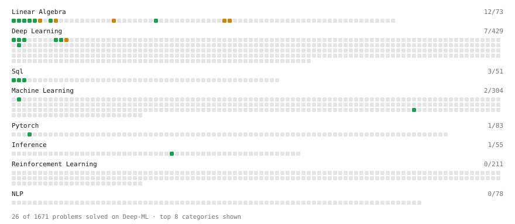

# Deep-ML

My machine learning practice from [Deep-ML](https://www.deep-ml.com). Every solution here was written by hand.

**31** solved · 25 problems · 0 labs · 6 math

[**Browse the interactive portfolio**](https://Shubhamkira10.github.io/deep-ml/) to replay this filling in over time.

## Problems

| | Difficulty | Solved | |
| --- | --- | --- | --- |
| [Balance Dataset via Undersampling](https://www.deep-ml.com/problems/1057) | easy | 2026-10-14 | [solution](problems/1057-balance-dataset-via-undersampling) |
| [Calculate 2x2 Matrix Inverse](https://www.deep-ml.com/problems/8) | easy | 2026-10-22 | [solution](problems/0008-calculate-2x2-matrix-inverse) |
| [Calculate Mean by Row or Column](https://www.deep-ml.com/problems/4) | easy | 2026-10-16 | [solution](problems/0004-calculate-mean-by-row-or-column) |
| [Calculate Number of Parameters in Neural Network](https://www.deep-ml.com/problems/371) | easy | 2026-10-09 | [solution](problems/0371-calculate-number-of-parameters-in-neural-network) |
| [Dot Product Calculator](https://www.deep-ml.com/problems/83) | easy | 2026-10-21 | [solution](problems/0083-dot-product-calculator) |
| [Filter rows with WHERE](https://www.deep-ml.com/problems/1103) | easy | 2026-10-18 | [solution](problems/1103-filter-rows-with-where) |
| [Implement a Linear Layer Forward Pass with Matrix Multiplication](https://www.deep-ml.com/problems/883) | easy | 2026-10-09 | [solution](problems/0883-implement-a-linear-layer-forward-pass-with-matrix-multiplication) |
| [Implement ReLU Activation Function](https://www.deep-ml.com/problems/42) | easy | 2026-10-08 | [solution](problems/0042-implement-relu-activation-function) |
| [Leaky ReLU Activation Function](https://www.deep-ml.com/problems/44) | easy | 2026-10-08 | [solution](problems/0044-leaky-relu-activation-function) |
| [Linear Regression Using Gradient Descent](https://www.deep-ml.com/problems/15) | easy | 2026-10-11 | [solution](problems/0015-linear-regression-using-gradient-descent) |
| [Matrix-Vector Dot Product](https://www.deep-ml.com/problems/1) | easy | 2026-10-06 | [solution](problems/0001-matrix-vector-dot-product) |
| [Reshape Matrix](https://www.deep-ml.com/problems/3) | easy | 2026-10-10 | [solution](problems/0003-reshape-matrix) |
| [Scalar Multiplication of a Matrix](https://www.deep-ml.com/problems/5) | easy | 2026-10-11 | [solution](problems/0005-scalar-multiplication-of-a-matrix) |
| [SELECT all rows](https://www.deep-ml.com/problems/1101) | easy | 2026-10-17 | [solution](problems/1101-select-all-rows) |
| [Select specific columns](https://www.deep-ml.com/problems/1102) | easy | 2026-10-16 | [solution](problems/1102-select-specific-columns) |
| [Sigmoid Activation Function Understanding](https://www.deep-ml.com/problems/22) | easy | 2026-10-15 | [solution](problems/0022-sigmoid-activation-function-understanding) |
| [Single Neuron](https://www.deep-ml.com/problems/24) | easy | 2026-10-05 | [solution](problems/0024-single-neuron) |
| [Softmax Activation Function Implementation ](https://www.deep-ml.com/problems/23) | easy | 2026-10-08 | [solution](problems/0023-softmax-activation-function-implementation) |
| [Streaming ASR Latency Budget: Chunk Size, Real-Time Factor and Round Trip](https://www.deep-ml.com/problems/1442) | easy | 2026-10-20 | [solution](problems/1442-streaming-asr-latency-budget-chunk-size-real-time-factor-and-round-trip) |
| [Transpose of a Matrix](https://www.deep-ml.com/problems/2) | easy | 2026-10-07 | [solution](problems/0002-transpose-of-a-matrix) |
| [Calculate Eigenvalues of a Matrix](https://www.deep-ml.com/problems/6) | medium | 2026-10-18 | [solution](problems/0006-calculate-eigenvalues-of-a-matrix) |
| [Gaussian Elimination for Solving Linear Systems](https://www.deep-ml.com/problems/58) | medium | 2026-10-25 | [solution](problems/0058-gaussian-elimination-for-solving-linear-systems) |
| [Implement Adam Optimization Algorithm](https://www.deep-ml.com/problems/49) | medium | 2026-10-13 | [solution](problems/0049-implement-adam-optimization-algorithm) |
| [LU Decomposition of a Square Matrix](https://www.deep-ml.com/problems/333) | medium | 2026-10-25 | [solution](problems/0333-lu-decomposition-of-a-square-matrix) |
| [Matrix times Matrix ](https://www.deep-ml.com/problems/9) | medium | 2026-10-17 | [solution](problems/0009-matrix-times-matrix) |

## Math

| | Difficulty | Solved | |
| --- | --- | --- | --- |
| [Matrix Basics](https://www.deep-ml.com/math-problems/9) | easy | 2026-10-20 | [solution](math/0009-matrix-basics) |
| [Vector Operations](https://www.deep-ml.com/math-problems/7) | easy | 2026-10-20 | [solution](math/0007-vector-operations) |
| [Inverse and Rank](https://www.deep-ml.com/math-problems/12) | medium | 2026-10-22 | [solution](math/0012-inverse-and-rank) |
| [Matrix Multiplication](https://www.deep-ml.com/math-problems/10) | medium | 2026-10-20 | [solution](math/0010-matrix-multiplication) |
| [Solving Linear Systems](https://www.deep-ml.com/math-problems/13) | medium | 2026-10-22 | [solution](math/0013-solving-linear-systems) |
| [Matrix Decompositions: LU and QR](https://www.deep-ml.com/math-problems/15) | hard | 2026-10-22 | [solution](math/0015-matrix-decompositions-lu-and-qr) |

---

_This file is regenerated by Deep-ML on every push._
